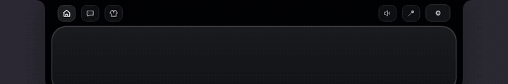
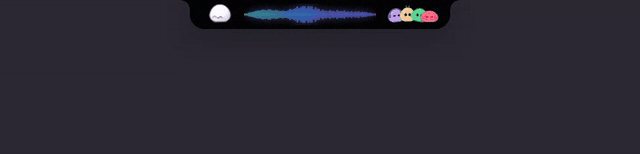
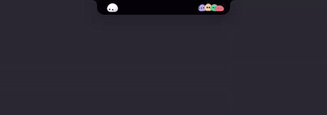
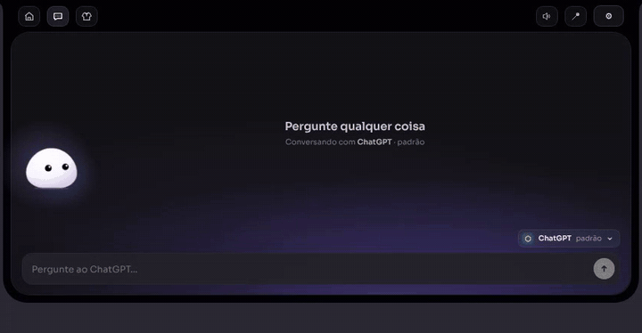
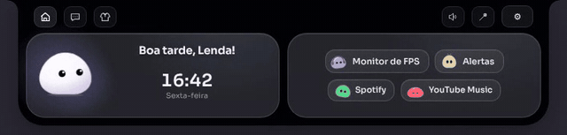
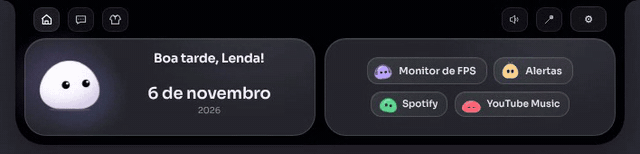
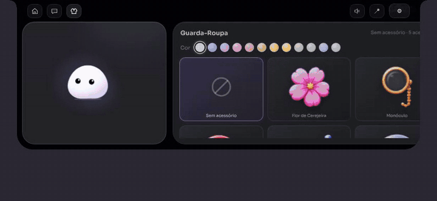

# Lad.

**Uma ilha no topo da tela do Windows, com um companheiro morando nela.**

[**⬇ Baixar o Lad.**](https://github.com/lordlalau/lad/releases/latest)

---

# A ilha e a música

Fica pequena no topo da tela e se abre quando o mouse chega perto. Dentro dela mora o **Lad.**, que pisca, segue o mouse com os olhos, cochila e curte a sua música.

Mostra o que está tocando no **Spotify** e no **YouTube Music**, com capa e controles. Na ilha compacta, aparecem **ondas animadas** no ritmo da música.

---

# Monitor de FPS

**FPS do jogo em tempo real**, mais 1% Low, frametime, CPU, GPU e temperatura, com gráfico. Com a ilha compacta, os números ficam à vista no topo da tela.

Os números do GIF são de demonstração.

---

# Chat com IA

Converse com o **ChatGPT** (pela sua conta ou com chave de API) ou com o **Claude**. Ele pesquisa na internet e **gera imagens**. Clique numa imagem para ver em tela cheia.

A geração de imagem pela conta exige ChatGPT Go ou superior.

---

# Alertas

**Cronômetros** e **alarmes** com dia e horário. Quando chega a hora, a ilha vibra, toca um som e o Lad. leva um susto.

---

# Lembretes

A cada 2 horas, o Lad. lembra você de beber água. De madrugada, ele avisa que já está tarde.

---

# Mini Lads

Cada ferramenta tem o seu Lad. em miniatura, com cor e jeitinho próprios. Se você quiser, o Lad. grande também **fica da cor da ferramenta** que você escolher.

---

# Guarda-Roupa

**12 cores pastel** para deixar o Lad. do seu jeito.

---

# E mais

- **Atualiza sozinho**: quando sai uma versão nova, é só um clique.
- **Leve**: instalador de 2,4 MB e economia de memória quando a ilha está compacta.
- **Configurações** para o seu nome, a cidade do clima, os sons, o jeito da ilha compacta e muito mais.
- **Inicia com o Windows**, se você quiser.

---

# Como instalar

1. Abra a página de [**Releases**](https://github.com/lordlalau/lad/releases/latest).
2. Em **Assets**, baixe o arquivo **`Lad_x.x.x_x64-setup.exe`**.
3. Abra o instalador.
4. Se aparecer **"O Windows protegeu o computador"**, clique em **Mais informações** e depois em **Executar assim mesmo**. O aviso aparece porque o app é novo.
5. Para ver o FPS dos jogos, aceite instalar o **PresentMon** quando o instalador perguntar.

Requer **Windows 10 ou 11 (64 bits)**.

---

© 2026 Lad. Todos os direitos reservados.

